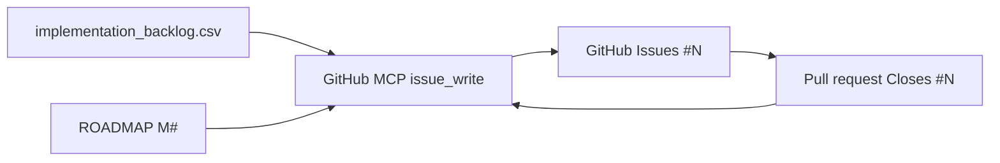

# GitHub traceability (jobby) — MCP only

Read `.jobby/GITHUB.md` first.

## Mandatory: GitHub MCP

All GitHub reads and writes use the **built-in GitHub MCP server**:

- Namespace: `plugin-github-github`
- Config: Cursor **Plugins → GitHub** (PAT with `repo`, Issues, Pull requests)
- Docs: https://docs.github.com/en/copilot/how-tos/context/use-mcp/use-the-github-mcp-server

### Before any GitHub call

1. `GetDynamicTools` with `namespace: plugin-github-github`
2. If status is `needsAuth`, `error`, or `loading` → `CallDynamicTool` `mcp_auth`, then re-check
3. If still unavailable → **stop** and tell the user to fix **Cursor Settings → Plugins → GitHub** (do not fall back to `gh` or shell scripts)

### Repo (always)

| Field | Value |
|---|---|
| `owner` | `ahmedyusef9` |
| `repo` | `jobby` |

Never track jobby product work on `santifer/career-ops`.

## MCP tools for traceability

Discover schemas with `GetDynamicTools` before each call. Primary tools:

| Action | MCP tool | Notes |
|---|---|---|
| Create issue | `issue_write` | `method: create`, include `<!-- jobby-sync:JOBBY-BL-### -->` in body |
| Update / close issue | `issue_write` | `method: update`, `state`, `milestone`, `labels` |
| List / find issues | `list_issues` or `search_issues` | Match title `[JOBBY-BL-###]` or body marker |
| Read issue | `issue_read` | `method: get` |
| Labels | `label_write`, `list_label` | Seed from `deploy/github/labels.json` |
| PRs | `create_pull_request`, etc. | Body includes `Closes #N` |

Assign milestones via `issue_write` → `milestone` (numeric id). Milestone titles and ids live in `deploy/github/milestones.json` (create missing milestones in GitHub UI once, then record numbers there).

## Local planning files (source of intent)

| File | Role |
|---|---|
| `.jobby/ROADMAP.md` | Milestones M1–M9 acceptance |
| `implementation_backlog.csv` | `JOBBY-BL-###` features |
| `deploy/github/milestone-map.json` | BL → M# |
| `deploy/design/*` | Design refs linked in issue bodies |
| `.jobby/github-issues.tsv` | Cache: BL → `#N` (refresh via `list_issues` + marker) |

**CSV/backlog is the plan; GitHub is the tracker.** Push plan → GitHub with MCP, not scripts.

## Workflow

### 1. Active milestone

Read `.jobby/ROADMAP.md`. Work the in-progress milestone unless the user reprioritizes.

### 2. Resolve backlog id

Use existing `JOBBY-BL-###` from CSV or add a row, then create the GitHub issue via MCP.

### 3. Create or update issue (MCP)

```text
issue_write:
  owner: ahmedyusef9
  repo: jobby
  method: create | update
  title: "[JOBBY-BL-020] Auth session + request-scoped tenant root"
  body: |
    <!-- jobby-sync:JOBBY-BL-020 -->
    … acceptance criteria from CSV …
  labels: [backlog, P0, status:in-progress, area:tenant]
  milestone: <number from milestones.json>
```

### 4. Branch / PR

- Branch: `feature/JOBBY-BL-###-slug`
- PR via MCP; body: `Closes #N`

### 5. Close loop

1. Update CSV `Status`
2. `issue_write` `method: update`, `state: closed` when Done
3. Refresh `.jobby/github-issues.tsv` via `list_issues`
4. SDLC report: `TASK_ID: #N`

## Diagram



## Forbidden

- `gh issue create`, `scripts/github-sync.mjs`, or any shell wrapper for GitHub mutations
- Upstream career-ops issue numbers in jobby SDLC reports
- Inventing `TASK_ID` values
- Editing `.github/` without mirroring under `deploy/github/`
