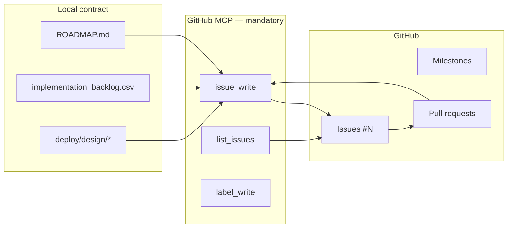

# GitHub traceability contract

Everything shippable is tracked on [ahmedyusef9/jobby](https://github.com/ahmedyusef9/jobby).

**All GitHub operations go through the built-in GitHub MCP server** (`plugin-github-github` in Cursor).
Do not use `gh` CLI or custom sync scripts for issues, milestones, labels, or PRs.

## Authority stack

| Layer | File / system | Role |
|---|---|---|
| Constitution | `.jobby/SYSTEM.md`, `DECISIONS.md` | invariants |
| Milestones | `.jobby/ROADMAP.md` ↔ GitHub Milestones M0–M9 | release “done” |
| Features | `implementation_backlog.csv` ↔ Issues `[JOBBY-BL-###]` | implementable units |
| Design | `deploy/design/*` | ADRs linked from issues |
| GitHub API | **GitHub MCP** (`issue_write`, `list_issues`, …) | sole write path |
| Agent reports | `TASK_ID: #N` | session handoff |

## Traceability flow

## ID rules

| Id | Format | Example |
|---|---|---|
| Backlog | `JOBBY-BL-###` | `JOBBY-BL-020` |
| Milestone | `M#` in ROADMAP | `M7 — Trusted execution` |
| GitHub issue | `#N` | `#20` |
| Branch | `feature/JOBBY-BL-###-slug` | `feature/JOBBY-BL-028-signin` |
| PR body | `Closes #N` | closes linked issue |

Every issue body must include: `<!-- jobby-sync:JOBBY-BL-### -->`

## MCP setup

1. **Cursor → Settings → Plugins → GitHub** — install, set PAT (`repo`, Issues, PRs)
2. Agent calls `GetDynamicTools` → `plugin-github-github`
3. If broken: re-auth via MCP or restart Cursor — **do not bypass with shell**

Official docs: https://docs.github.com/en/copilot/how-tos/context/use-mcp/use-the-github-mcp-server

## Agent workflow

1. Read ROADMAP + backlog row
2. **MCP** `issue_write` create/update on `ahmedyusef9/jobby`
3. Branch `feature/JOBBY-BL-###-*`
4. **MCP** create PR with `Closes #N`
5. Update CSV status → **MCP** close issue → refresh `.jobby/github-issues.tsv` via `list_issues`

Full steps: `.cursor/skills/github-trace/SKILL.md`

## Reference data (not executors)

| Path | Purpose |
|---|---|
| `deploy/github/milestones.json` | Milestone titles; record GitHub milestone **numbers** after first create |
| `deploy/github/milestone-map.json` | BL → M# |
| `deploy/github/labels.json` | Labels to seed via MCP `label_write` |
| `deploy/github/ISSUE_TEMPLATE/` | Install to `.github/` after upstream update |
| `.jobby/github-issues.tsv` | BL ↔ `#N` cache (maintained via MCP reads) |

## Durable vs installed

`.github/**` is upstream system layer. Mirror jobby templates under `deploy/github/` and copy manually after `update-system.mjs apply`.

## Related

- Rule: `.cursor/rules/30-github-trace.mdc`
- Skill: `.cursor/skills/github-trace/SKILL.md`
